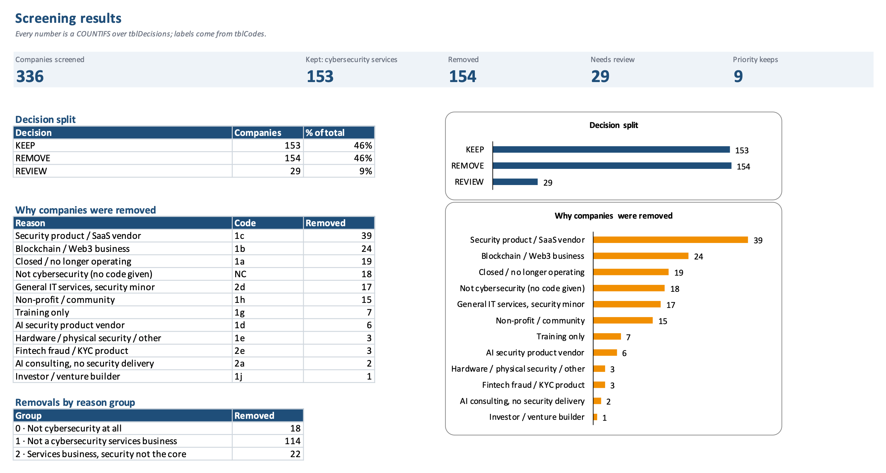

# Cybersecurity Provider Screening Audit (Excel)

A rule-based screening of **336 Singapore companies** to find the genuine cybersecurity services providers, with an
Excel audit workbook that re-checks the screening using live formulas. Each company gets exactly one decision
(**Keep 153**, **Remove 154**, **Review 29**) with a written reason, and every removal carries a reason code.


## What's inside
- **Decisions:** Keep = delivers cybersecurity services (9 flagged as priority); Remove = not a cybersecurity
  services provider; Review = unclear from the evidence.
- **Reason codes in three families:** not a cybersecurity services business (114), a services business where
  security isn't the core (22), not cybersecurity at all (18).
- **Top removal reasons:** security product / SaaS vendor (39), blockchain / Web3 (24), closed (19).
- **Coverage checks:** 9 live checks that turn red if any rule breaks.
- **Dashboard** of decisions and removals by reason code.



## How it works
- The checks run over two Excel Tables, the decisions (`tblDecisions`) and the reason codes (`tblCodes`): every row
  decided exactly once, no source row missing, every decision with a reason, every removal with a known code.
- Example formulas:
  ```excel
  Rows decided more than once  =ROWS(tblDecisions[Row ID]) - ROWS(UNIQUE(tblDecisions[Row ID]))
  Source rows with no decision =SUM(--ISNA(XMATCH(SEQUENCE($B$4, 1, 0), tblDecisions[Row ID])))
  ```
- **All 9 checks pass.** To prove they catch problems, a test copy decided one company twice: three checks turned
  red and the summary switched to **CHECK FAILED**.
- The kept providers are profiled in the
  [Singapore Cybersecurity Partner Scorecard](https://github.com/ainunizhar/Singapore-Cybersecurity-Partner-Scorecard).

## Data
- The screening data is not included in this repository. The audit workbook works on row numbers and reasons only,
  with no company names.

**Tools:** Excel (Microsoft 365): UNIQUE, SEQUENCE, XMATCH, FILTER, XLOOKUP, COUNTIFS, Excel Tables, conditional
formatting; Python for data preparation · built with Claude Code as a coding assistant
