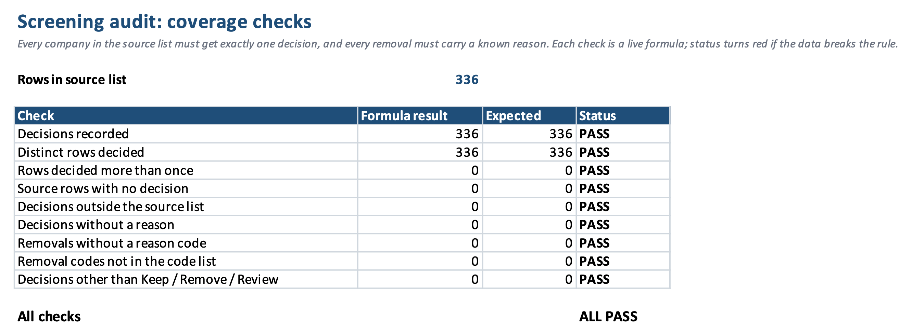

# Singapore Cybersecurity Provider Screening

A rule-based screening of **336 Singapore companies** from a cybersecurity company list, to find the genuine
**cybersecurity services providers**. Each company gets exactly one decision (**Keep**, **Remove** or **Review**)
with a written reason, and every removal carries a reason code.

An Excel audit workbook re-checks the screening with live formulas: every company decided exactly once, no gaps, and
every removal backed by a known code.



**Built with:** Excel (Microsoft 365): UNIQUE, SEQUENCE, XMATCH, FILTER, XLOOKUP, COUNTIFS, Excel Tables,
conditional formatting. Python for data preparation.

---

## The screening rules

| Decision | Meaning | Companies |
|---|---|---|
| **Keep** | Delivers cybersecurity services (managed security, SOC, incident response, pentesting, advisory) | 153, of which 9 flagged as priority |
| **Remove** | Not a cybersecurity services provider, with a reason code (below) | 154 |
| **Review** | Unclear from the evidence, e.g. a product that may or may not come with a managed service | 29 |

Removal reasons fall into three families:

| Family | Codes | Removed |
|---|---|---|
| **1 · Not a cybersecurity services business** | 1a closed · 1b blockchain / Web3 · 1c security product or SaaS vendor · 1d AI security product · 1e hardware / physical · 1g training only · 1h non-profit / community · 1j investor | 114 |
| **2 · Services business, but security isn't the core** | 2a AI consulting · 2d general IT services · 2e fintech fraud / KYC product | 22 |
| **0 · Not cybersecurity at all** | no code given (e.g. restaurant POS, media monitoring) | 18 |

The most common reasons: **security product / SaaS vendor (39)**, **blockchain / Web3 (24)** and **closed (19)**.


## The checks

The screening has to cover the source list exactly. These checks are live formulas over the decisions table
(`tblDecisions`) and the reason-code list (`tblCodes`), and the status turns red if any rule breaks:

| Check | Expected |
|---|---|
| Decisions recorded / distinct rows decided | 336 |
| Rows decided more than once | 0 |
| Source rows with no decision | 0 |
| Decisions outside the source list | 0 |
| Decisions without a reason | 0 |
| Removals without a reason code | 0 |
| Removal codes not in the code list | 0 |
| Decisions other than Keep / Remove / Review | 0 |

For example:

```excel
Rows decided more than once        =ROWS(tblDecisions[Row ID]) - ROWS(UNIQUE(tblDecisions[Row ID]))
Source rows with no decision       =SUM(--ISNA(XMATCH(SEQUENCE($B$4, 1, 0), tblDecisions[Row ID])))
Removal codes not in the code list =SUM(--ISNA(XMATCH(FILTER(tblDecisions[Reason Code], tblDecisions[Decision] = "REMOVE"),
                                                      tblCodes[Code])))
```

**All 9 checks pass.** To prove the checks actually catch problems, a test copy was built with one company
deliberately decided twice. Three checks turned red ("distinct rows decided" 335, "decided more than once" 1,
"no decision" 1) and the summary switched to **CHECK FAILED**.

## Data

The screening data is not included in this repository. The audit workbook works on row numbers and reasons only,
with no company names.
